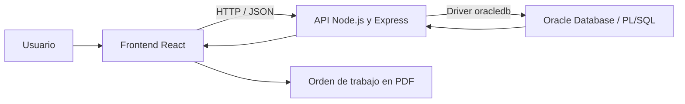

# MOLIPLUS

**Aplicación web para la programación de operaciones textiles y la gestión de molinetes.**

MOLIPLUS reúne la administración de parámetros textiles, la distribución de rollos por molinete, la estimación de tiempos de giro y la generación de órdenes de trabajo. Fue desarrollado en un contexto laboral y corporativo para apoyar la programación de producción a partir de información técnica centralizada.

Este repositorio presenta el proyecto como parte de mi portafolio profesional y agrupa sus tres componentes: frontend, backend y base de datos.

> **Disponibilidad del código:** los repositorios de implementación se mantienen privados para proteger la confidencialidad y la propiedad intelectual de la empresa. Este espacio comparte una descripción funcional y técnica general. Si te interesa conocer mi trabajo, podemos coordinar una presentación personal y, cuando exista autorización, una revisión del código.

## ¿Qué permite hacer?

| Área | Funcionalidades |
| --- | --- |
| Parámetros textiles | Administrar tallas, tipos de hilaza y parámetros de peso, ancho y promedios asociados a cada combinación de hilaza y talla. |
| Rendimientos | Gestionar rendimientos por talla y la información utilizada para estimar los metros por rollo. |
| Molinetes | Administrar los equipos y sus parámetros técnicos, como revoluciones por minuto y perímetro. |
| Programación | Seleccionar hilaza y tallas, distribuir rollos entre molinetes y ajustar las RPM de la programación. |
| Tiempo de giro | Previsualizar metros y tiempos estimados por molinete, con una gráfica comparativa de los tiempos calculados. |
| Órdenes de trabajo | Registrar la programación, asociar información de lotes u hojas de ruta y máquinas, y generar el documento de trabajo en PDF. |
| Consulta de órdenes | Buscar órdenes por número, tipo de hilaza y rango de fechas; consultar sus detalles y generar su PDF para impresión. |
| Usuarios y permisos | Iniciar y cerrar sesión, administrar usuarios y configurar permisos por módulo y acción: consulta, creación, actualización, eliminación y reportes. |

Los tiempos mostrados son estimaciones de programación basadas en los parámetros registrados.

## Flujo de uso

1. El usuario inicia sesión y accede a los módulos habilitados para su cuenta.
2. Configura o consulta los catálogos, rendimientos y parámetros textiles.
3. Selecciona el tipo de hilaza y las tallas que participarán en la programación.
4. Distribuye los rollos entre los molinetes y revisa los metros y tiempos estimados.
5. Registra la orden de trabajo y sus datos complementarios.
6. Consulta las órdenes guardadas y genera el PDF correspondiente.

## Tecnologías

| Componente | Tecnologías utilizadas |
| --- | --- |
| Frontend | JavaScript, React 19, React Router 7, Vite 8, Material UI, Emotion y CSS. |
| Comunicación HTTP | Axios y API HTTP con intercambio de datos en JSON. |
| Backend | Node.js con módulos ES y Express 5. |
| Base de datos | Oracle Database y PL/SQL mediante paquetes y procedimientos almacenados. |
| Integración con Oracle | Driver `oracledb`, pool de conexiones, parámetros enlazados y cursores de consulta. |
| Sesión y autorización | JSON Web Tokens (JWT), cookies HttpOnly y validación de permisos en el backend. |
| Reportes | jsPDF y jsPDF-AutoTable para generar órdenes de trabajo en PDF. |
| Herramientas | Git, submódulos de Git, npm, ESLint y Nodemon. |

## Arquitectura

El sistema separa la interfaz de usuario, la API y la lógica de datos en tres componentes versionados de forma independiente.

- **Frontend:** organiza las pantallas en páginas y componentes reutilizables. Utiliza hooks y contextos para gestionar estado, sesión y permisos, y concentra las llamadas a la API en servicios.
- **Backend:** separa rutas, middlewares, controladores y servicios. Gestiona la sesión, comprueba permisos y comunica cada operación con Oracle.
- **Base de datos:** concentra operaciones de negocio, validaciones y persistencia en paquetes PL/SQL, con sus especificaciones y cuerpos separados.

La interfaz ofrece una vista previa de la programación; Oracle realiza los cálculos que se registran. Los reportes consultan los datos persistidos de la orden.

## Organización de los repositorios

| Repositorio | Responsabilidad | Acceso |
| --- | --- | --- |
| [molinetes-frontend](https://github.com/juanserna1711/molinetes-frontend) | Interfaz web, navegación, formularios, programación y reportes PDF. | Privado |
| [molinetes-backend](https://github.com/juanserna1711/molinetes-backend) | API, autenticación, autorización e integración con Oracle. | Privado |
| [molinetes-database](https://github.com/juanserna1711/molinetes-database) | Versionado de especificaciones y cuerpos de paquetes PL/SQL. | Privado |

El repositorio padre utiliza **submódulos de Git** para relacionar cada componente con una revisión específica de su código. Cada repositorio conserva su propio historial de cambios.

Los enlaces a los componentes requieren autorización de acceso en GitHub. Clonar este repositorio público no concede acceso al código de los submódulos privados.

## Enfoque de desarrollo

El proyecto está organizado por módulos funcionales y responsabilidades técnicas:

- Separación de presentación, comunicación HTTP y operaciones de base de datos.
- Servicios por recurso tanto en el frontend como en el backend.
- Reutilización de componentes para formularios, tablas, confirmaciones y notificaciones.
- Validaciones de captura en la interfaz y validaciones de negocio en Oracle.
- Manejo de errores de la base de datos y respuestas comprensibles para el usuario.
- Control de versiones independiente por componente, con ramas `main` y `develop`.
- Documentación de responsabilidades y modificaciones dentro de los archivos fuente.

## Sobre este portafolio

MOLIPLUS refleja mi experiencia conectando **React, Node.js y Oracle** para construir una solución orientada a procesos textiles: desde la interfaz y la API hasta los procedimientos PL/SQL y los reportes operativos.

La documentación pública omite credenciales, datos de producción, configuraciones de infraestructura y detalles internos de las reglas de negocio. La publicación de esta descripción no concede una licencia de uso o distribución del software privado.

**Desarrollado por [Juan Andrés Serna Castro](https://github.com/juanserna1711).**

Para conversar sobre el proyecto o coordinar una demostración, puedes contactarme a través de los canales disponibles en mi perfil de GitHub.
